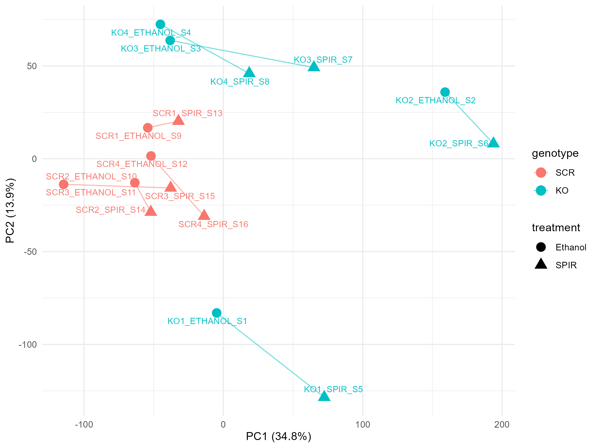
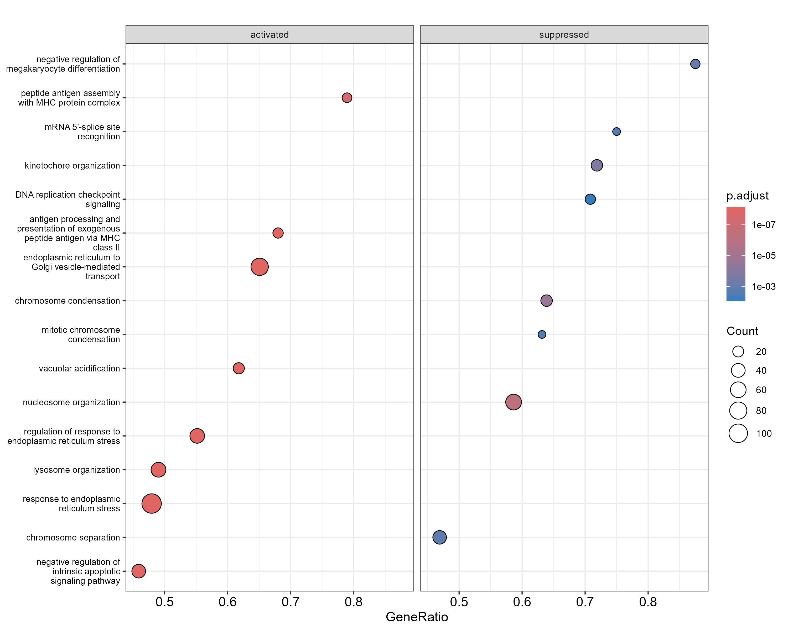

# PANX1 knockout and spironolactone in A375-P melanoma cells: RNA-seq reanalysis

Independent reanalysis of public RNA-seq data (GEO: [GSE348006](https://www.ncbi.nlm.nih.gov/geo/query/acc.cgi?acc=GSE348006)) from the study *Pannexin 1 Ablation Disrupts Cell Cycle Progression and Compromises the Structure of Melanoma Tumours*.

## Question

Does PANX1 knockout downregulate cell-cycle genes in A375-P melanoma cells, and does spironolactone treatment amplify the effect?

## Data

- 16 bulk RNA-seq samples: scrambled control (SCR) or PANX1 knockout (KO), each treated with spironolactone (SPIR) or ethanol vehicle. Four clones per genotype, and each clone received both treatments (paired design).
- The only expression matrix available was the authors' Partek-normalized counts, not raw counts, so I used limma on log2 values instead of DESeq2.

## Methods

1. Filtered low-expressed genes (normalized count of at least 10 in at least 4 samples; 20,025 of 25,635 genes kept).
2. PCA for quality control.
3. limma model with genotype, treatment, and their interaction, with `duplicateCorrelation` to account for the paired clones.
4. Gene set enrichment analysis (GSEA) on GO Biological Process terms with clusterProfiler, ranking all genes by moderated t statistic.

## Key results

| Comparison | Genes with adj. p < 0.05 |
|---|---|
| KO vs SCR | 29 |
| SPIR vs ethanol (in SCR cells) | 1,770 |
| Interaction (KO x SPIR) | 0 |

- Cell-cycle and DNA replication gene sets were lower in KO cells and lower with spironolactone, consistent with the original paper.
- The pathway-level interaction was also negative, but no single gene passed FDR 0.05 for the interaction, so I treat this as suggestive, not confirmed.

## Limitations

- Started from normalized, not raw, counts.
- Only four clones per genotype, so power for the interaction is low and clone effects are possible.
- GSEA permutes gene labels, which can make pathway p-values optimistic.
- *PANX1* mRNA did not drop in KO cells. Knockout efficiency would need protein-level confirmation, which is outside this analysis.

## How to reproduce

1. Download `GSE348006_Partek_Penuela_16_Normalization_Normalized_counts.txt.gz` from the GEO page above and place it in a folder named `data/`.
2. Install the packages listed at the top of `analysis.R` (section 0).
3. Run `analysis.R`. It writes tables to `results/` and figures to `figures/`.
4. Render `report.qmd` in RStudio to produce the HTML report.

## Files

| File | Contents |
|---|---|
| `analysis.R` | Full analysis script |
| `report.qmd` | Quarto report source |
| `report.html` | Rendered report (download to view) |
| `results/` | limma and GSEA result tables, session info |
| `figures/` | Figures used in the report |

## Tools

R, tidyverse, limma, clusterProfiler, enrichplot, ggplot2, Quarto
