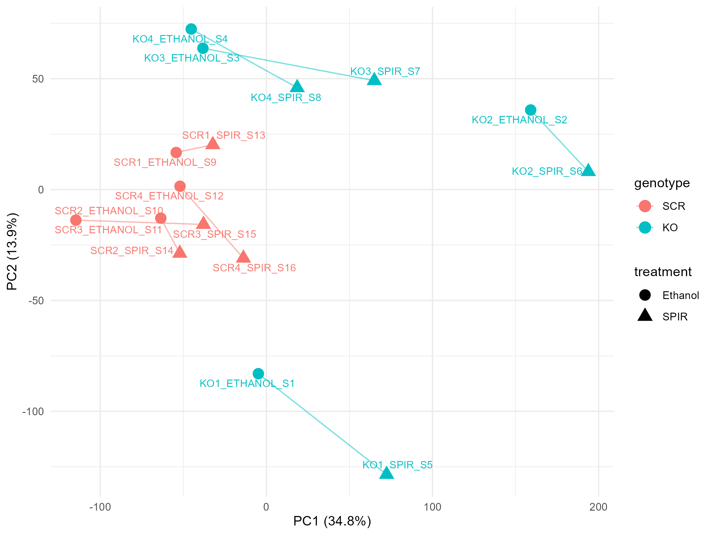
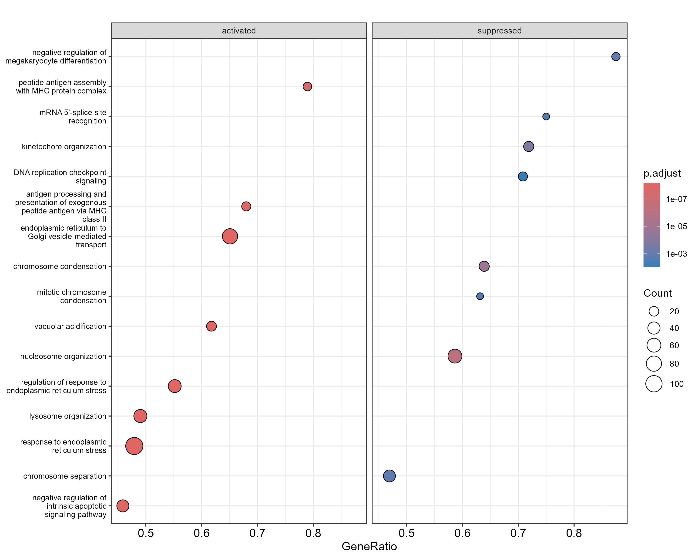
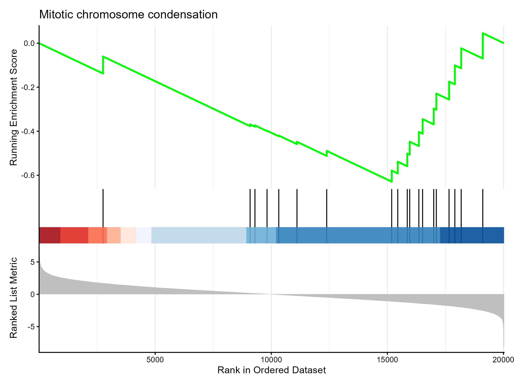

```{r setup}
library(tidyverse)
library(knitr)

# Results written by analysis.R (run that script first)
ko    <- read_csv("results/limma_KO_vs_SCR.csv",          show_col_types = FALSE)
spir  <- read_csv("results/limma_SPIR_vs_Ethanol.csv",    show_col_types = FALSE)
inter <- read_csv("results/limma_interaction.csv",        show_col_types = FALSE)
g_ko    <- read_csv("results/gsea_KO_vs_SCR.csv",         show_col_types = FALSE)
g_spir  <- read_csv("results/gsea_SPIR_vs_Ethanol.csv",   show_col_types = FALSE)
g_inter <- read_csv("results/gsea_interaction.csv",       show_col_types = FALSE)

n_sig <- function(r) sum(r$adj.P.Val < 0.05)

cc_pattern <- "cell cycle|mitotic|DNA replication|chromosome segregation"
cc <- function(g) g %>% filter(str_detect(Description, cc_pattern))
nes_range <- function(g) {
  x <- cc(g)$NES
  sprintf("%.2f to %.2f", min(x), max(x))
}

panx <- ko %>% filter(gene_name == "PANX1")
```

## Summary

Pannexin 1 (PANX1) is a channel protein implicated in melanoma growth and invasion. The original study (GEO GSE348006) used RNA-seq of A375-P melanoma cells to test how PANX1 knockout (KO) and the channel inhibitor spironolactone (SPIR) affect gene expression. I reanalyzed the processed data with an independent pipeline in R (limma and clusterProfiler) to ask:

> Does PANX1 knockout downregulate cell-cycle genes, and does spironolactone amplify the effect?

**Main findings**

- Cell-cycle and DNA replication gene sets were lower in KO cells (`r nrow(cc(g_ko))` related GO terms, NES `r nes_range(g_ko)`).
- Spironolactone lowered the same gene sets in control cells (NES `r nes_range(g_spir)`).
- At the pathway level, the interaction was also negative (NES `r nes_range(g_inter)`), consistent with a stronger effect in KO cells. No individual gene reached significance for the interaction, so this is suggestive, not conclusive.

## Data and design

- **Source:** GEO GSE348006, A375-P melanoma cells, bulk RNA-seq.
- **Design:** 2 x 2, scrambled control (SCR) or PANX1 KO, each treated with 10 µM spironolactone or ethanol vehicle for five days.
- **Samples:** 16 (4 clones per genotype). Each clone was treated with both ethanol and spironolactone, so samples are paired by clone.
- **Input:** Partek-normalized counts supplied by the authors, not raw counts. For that reason I used limma on log2 values and not DESeq2.

## Methods

1. Kept genes with a normalized count of at least 10 in at least 4 samples (`r format(nrow(ko), big.mark = ",")` genes retained of 25,635).
2. Log2-transformed (log2(x + 1)) and inspected sample structure with PCA.
3. Fit a limma model with genotype, treatment, and their interaction, using `duplicateCorrelation` to account for repeated measures within each clone, then empirical Bayes moderation with a mean-variance trend.
4. Ranked all genes by the moderated t statistic and ran gene set enrichment analysis (GSEA) on GO Biological Process terms with clusterProfiler. Near-duplicate GO terms were merged with `simplify()` for plotting.

Full code is in `analysis.R`.

## Results

### Sample structure

```{r}
#| fig-cap: "PCA of 16 samples. Lines join the two samples from the same clone."

```

Control (SCR) samples cluster tightly, while KO clones are more spread out, consistent with clone-to-clone variation. Within each clone, the spironolactone sample sits to the right of its ethanol partner, so the treatment effect is consistent across pairs. This is why the model accounts for clone pairing.

### Differential expression

| Comparison | Genes with adjusted p < 0.05 |
|------------|------------------------------|
| KO vs SCR (ethanol) | `r n_sig(ko)` |
| SPIR vs ethanol (SCR cells) | `r n_sig(spir)` |
| Interaction (KO x SPIR) | `r n_sig(inter)` |

Top genes for KO vs SCR:

```{r}
ko %>%
  slice_head(n = 10) %>%
  transmute(Gene = gene_name, log2FC = round(logFC, 2),
            `Adj. p` = signif(adj.P.Val, 2)) %>%
  kable()
```

*PANX1* mRNA itself was essentially unchanged in KO cells (log2FC = `r round(panx$logFC, 2)`, adjusted p = `r round(panx$adj.P.Val, 2)`). This does not show the knockout failed: CRISPR edits often disrupt the protein without lowering mRNA, and knockout efficiency would be confirmed at the protein level.

### Pathway enrichment: KO vs SCR

```{r}
#| fig-cap: "GSEA of GO Biological Process terms, KO vs SCR (after merging similar terms). 'Suppressed' = lower in KO."

```

Chromosome segregation, kinetochore, chromosome condensation, and DNA replication terms were suppressed in KO cells. Several terms were also higher in KO (antigen presentation, ER-to-Golgi transport, lysosome organization). These were not part of the original question, and with four clones per group I treat them as observations to follow up, not findings.

```{r}
#| fig-cap: "GSEA running score for mitotic chromosome condensation. Genes in the set concentrate among those lower in KO."

```

Cell-cycle related terms in KO vs SCR (most negative first):

```{r}
cc(g_ko) %>%
  arrange(NES) %>%
  slice_head(n = 10) %>%
  transmute(Term = Description, NES = round(NES, 2),
            `Adj. p` = signif(p.adjust, 2)) %>%
  kable()
```

### Spironolactone and the interaction

```{r}
bind_rows(
  cc(g_spir)  %>% mutate(Comparison = "SPIR vs ethanol (SCR cells)"),
  cc(g_inter) %>% mutate(Comparison = "Interaction (KO x SPIR)")
) %>%
  group_by(Comparison) %>%
  arrange(NES, .by_group = TRUE) %>%
  slice_head(n = 5) %>%
  transmute(Comparison, Term = Description, NES = round(NES, 2),
            `Adj. p` = signif(p.adjust, 2)) %>%
  kable()
```

In control cells, spironolactone lowered cell-cycle gene sets, consistent with the authors' report that it affects the cell cycle regardless of PANX1. The negative interaction means this drop was larger in KO cells.

## Limitations

- **Normalized, not raw, counts.** The authors' Partek-normalized values were the only expression matrix available to me, which limits the choice of method.
- **Small sample and clone effects.** Four clones per genotype gives little power, especially for the interaction, and clones can differ for reasons unrelated to PANX1.
- **Pathway-level evidence for the interaction is likely optimistic.** GSEA assesses significance by permuting gene labels, which ignores correlation between genes in a pathway, and no individual gene passed FDR 0.05 for the interaction. I describe this as consistent with the original claim and not as confirmation.
- **Redundant GO terms.** The many cell-cycle terms are largely one signal seen through overlapping gene sets, not independent findings.
- **No protein-level check.** *PANX1* mRNA did not drop in KO cells, and knockout efficiency was not assessed here.
- **Ties in the ranking.** About 0.14% of genes had identical statistics and were ordered arbitrarily, which is too few to affect the conclusions.

## Reproducibility

Code, results tables, and figures are in the project repository. Run `analysis.R` first, then render this report. Package versions are recorded in `results/sessionInfo.txt`.

**Data:** GEO accession GSE348006. Original study: *Pannexin 1 Ablation Disrupts Cell Cycle Progression and Compromises the Structure of Melanoma Tumours*.
